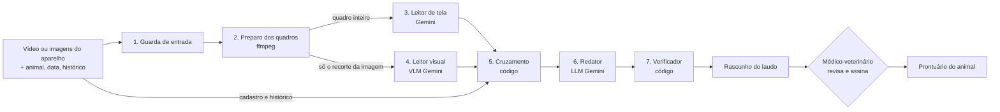

# Agente de Ultrassonografia AcomGest

Agente de IA que transforma o vídeo ou as imagens exportados do aparelho de ultrassom em um rascunho de prontuário do animal, cruzado com o histórico reprodutivo, para o médico-veterinário revisar e assinar. Roda dentro do módulo de Ultrassom da [AcomGest](https://app.acomgest.com.br), plataforma de gestão pecuária.

Projeto apresentado no **AKCIT Camp Multicêntrico 2026 — Hackathon Centro-Oeste (Goiânia, 24/10/2026)**.

## Fluxo do agente: entradas, lógica e saídas



O orquestrador ([src/harness.js](src/harness.js)) é código comum: ele decide a ordem das etapas, os limites e o que acontece quando algo falha. O modelo só aparece em três etapas (3, 4 e 6), sempre com um contrato JSON fixo.

### Entradas

| Entrada | Origem | Usada por |
| --- | --- | --- |
| Vídeo ou imagens do exame (MP4, MOV, AVI, JPEG, PNG; até 4 arquivos e 14 MB no total) | exportado do aparelho de ultrassom | Guarda, Preparo dos quadros, Leitores |
| Animal (id, brinco, nome) | cadastro da AcomGest | Guarda e Cruzamento. **Nunca vai para o Leitor visual** |
| Data do exame, aparelho, veterinário | formulário do exame | Guarda e Cruzamento |
| Histórico: serviços reprodutivos (IA, IATF, cobertura, TE) e exames de ultrassom anteriores | registros da AcomGest | só Cruzamento. **Nunca vai para o Leitor visual** |

### Lógica, etapa por etapa

| # | Etapa | Tipo | O que faz | Se der errado |
| --- | --- | --- | --- | --- |
| 1 | **Guarda de entrada** ([inputGuard.js](src/agents/inputGuard.js)) | código | Confere animal, data, tipo, tamanho e quantidade dos arquivos, e calcula o SHA-256 de cada arquivo | `entrada_recusada`, sem chamar o modelo |
| 2 | **Preparo dos quadros** ([frames.js](src/frames.js)) | código (ffmpeg) | Extrai 8 quadros distribuídos ao longo de cada vídeo, cada um com o seu instante. Recorta a região da imagem de ultrassom (por densidade de pixels), separando-a das bordas com texto. Se a região não for encontrada, o quadro segue inteiro, o Leitor visual é avisado e sai o alerta `recorte_nao_encontrado`. Registra a cobertura: quantos quadros, em quais instantes, de quantos segundos de vídeo | `falha_no_processamento`, que é diferente de "sem achados" |
| 3 | **Leitor de tela** ([reader.js](src/agents/reader.js), prompt `ultrassom-tela-v1`) | Gemini | Recebe o quadro inteiro e **só transcreve** os textos da tela, com a posição e o papel provável (identificação do paciente, data/hora, aparelho, transdutor, medida…). Não decide o que um texto significa. Medida só entra quando foi feita na tela | `leitura_invalida` após 1 nova tentativa |
| 4 | **Leitor visual** ([reader.js](src/agents/reader.js), prompt `ultrassom-visual-v3`) | VLM Gemini | Recebe **só os recortes numerados** ("Quadro k · t s"), sem cadastro, histórico ou texto da tela. Para cada estrutura: identificação e status (identificado / hipótese / não identificado com segurança), quadros onde aparece, evidência visual, forma, contornos, ecogenicidade, ecotextura, conteúdo, relações, possível artefato, estado (compatível / alteração morfológica suspeita / inconclusiva), alterações suspeitas (achado observado → significado possível → hipótese patológica e diferenciais → como confirmar) e limitações. Lista também o que não foi possível avaliar, a situação da gestação e uma interpretação preliminar. Não inventa lateralidade, medidas, contagens, batimentos nem porcentagens | `leitura_invalida` após 1 nova tentativa; `falha_no_modelo` se o Gemini não responder |
| — | **Normalização** ([schema.js](src/schema.js)) | código | Valida o contrato. Uma estrutura "identificada" sem quadro conferível vira "hipótese"; uma gestação sem quadro vira "inconclusiva"; estruturas fora da lista reprodutiva são marcadas | — |
| 5 | **Cruzamento** ([crossCheck.js](src/agents/crossCheck.js)) | código | Compara as fontes entre si, **sem decidir qual está certa**: texto da tela × cadastro, data da tela × data do exame, medida da tela × faixa de referência, idade gestacional medida × dias desde o último serviço, achado atual × exame anterior positivo | Verificações com severidade `bloqueio`, `alerta` ou `info` |
| 6 | **Redator** ([writer.js](src/agents/writer.js)) | LLM Gemini | Escreve a narrativa do rascunho só com os fatos: achados com os quadros, cobertura da amostragem, o que não foi avaliável e os pontos de conferência | Se falhar, entra o texto-modelo determinístico |
| 7 | **Verificador** ([writer.js](src/agents/writer.js)) | código | Recusa a narrativa se ela tiver um número que não está nos fatos ou um termo de recomendação, prescrição ou diagnóstico definitivo | Entra o texto-modelo determinístico |

**Verificações do Cruzamento**

| Código | Severidade | Quando aparece |
| --- | --- | --- |
| `imagem_inutilizavel` | bloqueio | o Leitor visual diz que a imagem não serve para análise |
| `recorte_nao_encontrado` | alerta | a região da imagem não foi isolada e o Leitor visual recebeu o quadro inteiro, com o texto da tela; conferir se algum achado veio do texto |
| `identificacao_a_conferir` | alerta | há um texto na área do paciente diferente do brinco ou nome cadastrado. O significado do texto não está confirmado: pode ser o animal, o proprietário ou outro campo |
| `identificacao_confere` / `identificacao_ausente_na_tela` | info | o texto bate com o cadastro / não há identificação na tela |
| `data_a_conferir` | alerta | a data da tela é diferente da data do exame; as duas aparecem |
| `medida_fora_da_faixa` | alerta | uma medida da tela fica fora da faixa configurada |
| `idade_gestacional_divergente` / `idade_gestacional_coerente` | alerta / info | a idade gestacional medida na tela, comparada com os dias desde o último serviço (tolerância de 10 dias) |
| `gestacao_sem_servico` | alerta | há estrutura gestacional, mas nenhum serviço reprodutivo registrado |
| `positivo_anterior` | alerta | o clipe não mostra gestação, mas houve um exame positivo antes. Isso não equivale a resultado negativo |

### Saídas

A resposta mantém cada fonte separada, para a tela mostrar de onde veio cada informação:

| Campo | Conteúdo | Fonte |
| --- | --- | --- |
| `screen` | textos da tela com posição e papel provável; data, aparelho, transdutor, medidas feitas na tela | texto da tela |
| `visual` | estruturas com quadros, características, estado, alterações suspeitas e limitações; `not_evaluated`; `gestation`; `preliminary_interpretation` | observação visual / interpretação sugerida |
| `frames` | miniaturas dos quadros analisados, com o número e o instante | arquivo do exame |
| `coverage` | quantos quadros, em quais instantes, de quantos segundos de vídeo | arquivo do exame |
| `checks` | verificações do Cruzamento, cada uma com severidade e seção (visual, conferência, histórico) | cruzamento |
| `history` | último serviço reprodutivo e exame anterior | histórico |
| `draft` | campos do exame para o prontuário. A gestação só vem como "Prenhe" quando o Leitor visual mostrou a estrutura; senão fica em branco para o veterinário. Medidas só da tela; `ai_confidence` sempre vazio | rascunho |
| `blocked`, `requiresVeterinarianApproval` | se há bloqueio para assinar; a aprovação é sempre obrigatória | — |
| `provenance` | versão dos prompts, modelos, recorte da imagem e SHA-256 dos arquivos | rastreabilidade |
| `trace` | cada etapa com horário, modelo, tokens, tempo e resultado | rastreabilidade |

`status` diz como a execução terminou: `rascunho_aguardando_veterinario`, `entrada_recusada`, `falha_no_processamento`, `leitura_invalida`, `falha_no_modelo` ou `sem_modelo`.

**Nada é gravado pelo agente.** Na AcomGest, o rascunho é salvo no módulo de Ultrassom e só vira prontuário quando um usuário com perfil Veterinário revisa e assina. A tela mostra o laudo nesta ordem: achados visuais, interpretação preliminar, limitações, comparação com exames anteriores, conferência de cadastro, identificação e datas, e revisão veterinária. As identificações de estruturas são experimentais e ainda não têm desempenho validado.

## Documentação

| Documento | Conteúdo |
| --- | --- |
| [Fluxo do agente](#fluxo-do-agente-entradas-lógica-e-saídas) | Entradas, lógica e saídas (entregável do edital), nesta página |
| [Arquitetura](docs/arquitetura.md) | Componentes, por que vários agentes, onde fica o estado, implantação |
| [Especificação dos agentes](docs/especificacao-dos-agentes.md) | Área, contrato de entrada e saída, limites e interação de cada agente (base para os prompts) |
| [Avaliação e guardrails](docs/avaliacao-e-guardrails.md) | Proteções, testes executados, avaliação com exames reais |
| [Dados, LGPD e observabilidade](docs/lgpd-e-observabilidade.md) | Que dados passam, retenção, logs, como investigar uma resposta ruim |
| [BMC](docs/bmc.md) | Business Model Canvas |
| [Pitch de 3 minutos](docs/pitch-3min.md) | Roteiro e perguntas prováveis |

## Rodar

Requer Node.js 22 ou mais recente e o `ffmpeg` (no PATH, ou em `FFMPEG_PATH`) para extrair os quadros dos vídeos. No modo `--simulado`, o ffmpeg não é usado.

```bash
# testes do agente (modelo falso, sem chave)
node test/harness.test.js

# demonstração sem chave (leitura SIMULADA, marcada como tal)
node demo.js --simulado --file exame.png --animal 1042 --date 2026-10-20 --service 2026-09-05:IATF

# demonstração real
GEMINI_API_KEY=... GEMINI_MODEL=<modelo com visão> \
  node demo.js --file exame.mp4 --animal 1042 --date 2026-10-20 --service 2026-09-05:IATF

# avaliação com exames rotulados por veterinário
GEMINI_API_KEY=... GEMINI_MODEL=... node eval/run-eval.js <pasta-com-labels.json>
```

## Estado em 24/10/2026

| Parte | Situação |
| --- | --- |
| Orquestrador, Guarda, Preparo dos quadros, Leitores de tela e visual, Cruzamento, Redator, Verificador | Feitos e testados com modelo falso (10 cenários) |
| Vídeo real de referência (Mindray, AVI) | Rodado com o Gemini: fontes separadas, quadros citados, cobertura informada (`eval/validate-reference.js`) |
| Rota e tela no módulo de Ultrassom da AcomGest; aprovação só pelo Veterinário | Feitas e testadas no servidor (6 cenários, SQLite) |
| Qualidade da leitura com exames reais | Ainda não medida: falta o conjunto rotulado por veterinário |
| Armazenamento do arquivo do exame | A construir (hoje só o hash) |

## Correções de 24/10/2026

Conferência dos documentos contra o código v3. Ficou só o que existe de fato.

**No código**

- **Recorte da imagem não encontrado:** o Leitor visual recebia o quadro inteiro, com o texto da tela, sem aviso. Agora ele é avisado e sai o alerta `recorte_nao_encontrado` para o veterinário.
- **Avaliador (`eval/run-eval.js`):** lia um campo da versão anterior e não media nada. Agora mede gestação, medidas da tela e estruturas identificadas.

**Nos documentos**

- **Arquitetura e especificação dos agentes:** reescritas. Antes falavam em um leitor único, porcentagem de confiança, "11 verificações" e "limite de 8 etapas". Hoje são 7 etapas, 10 verificações mais o alerta de recorte, e limite de 12 etapas.
- **LGPD:** dizia que o vídeo vai ao Gemini e que a AcomGest guarda o hash. Na verdade vão os quadros extraídos, que são apagados no fim. O hash só aparece na resposta da análise e no rodapé do laudo, não fica gravado.
- **BMC:** estava escrito "confere com a IA, a IATF". Virou "confere com a inseminação, a IATF".
- **Fluxo do agente:** agora aponta para este README, para não existirem duas versões diferentes.
- **Pitch:** atualizado para as 7 etapas e o laudo em 6 seções, sem porcentagens.

## Licença

MIT — ver [LICENSE](LICENSE).
