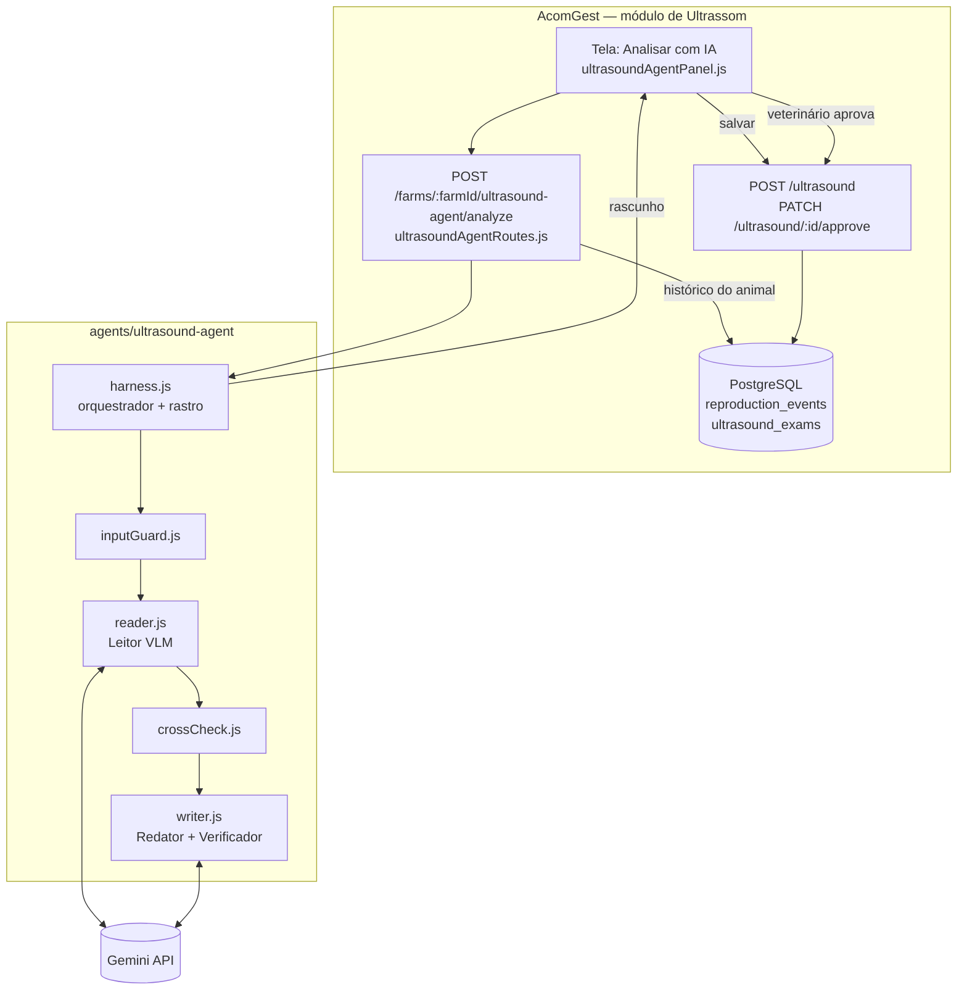

# Arquitetura

> **Atualização 24/10/2026 (v3):** o leitor único foi dividido em Preparo dos quadros, Leitor de tela e Leitor visual, e as porcentagens de confiança foram removidas. O fluxo atual, com entradas, lógica e saídas, está no [README](../README.md#fluxo-do-agente-entradas-lógica-e-saídas). Onde este documento falar em "Leitor (VLM)" ou em confiança por campo, vale o README.

O agente é um orquestrador com cinco papéis: dois usam IA (Leitor e Redator) e três são código determinístico (Guarda, Cruzamento e Verificador). A IA percebe e escreve; as regras conferem; o veterinário decide.

## Componentes

| Peça | Arquivo | Papel |
| --- | --- | --- |
| Orquestrador | `src/harness.js` | Chama as etapas em ordem, guarda o rastro, limita a 8 etapas, devolve um status explícito em toda saída |
| Guarda de entrada | `src/agents/inputGuard.js` | Tipo, tamanho e quantidade de arquivos; animal e data; hash SHA-256 |
| Leitor (VLM) | `src/agents/reader.js` | Prompt com regras de origem do dado; saída em JSON Schema (`src/schema.js`) validada pelo código; 1 nova tentativa |
| Cruzamento | `src/agents/crossCheck.js` | 11 verificações contra o histórico; cada uma carrega o dado que a originou |
| Redator + Verificador | `src/agents/writer.js` | LLM escreve só com os fatos; o Verificador recusa número inventado ou recomendação |
| Cliente Gemini | `src/gemini.js` | Chave no cabeçalho, temperatura 0, tempo-limite de 60 s, sem dependências |
| Modo simulado | `src/simulated.js` | Só para demonstração sem chave; a tela e a API marcam "simulado" |
| Rota na AcomGest | `backend/modules/ultrasound/agent/ultrasoundAgentRoutes.js` | Permissão, isolamento por fazenda, carrega o histórico, chama o agente, não grava |
| Tela | `frontend/src/domain/ultrasound/ultrasoundAgentPanel.js` | Upload, revisão, salvar rascunho, aprovação pelo veterinário |
| Regra de assinatura | `backend/controllers/farmResourceController.js` (`approveResourceAction`) | Exame com IA = Sim só é aprovado pelo perfil Veterinário |

## Por que vários agentes, e não um só

- **Separar perceber de conferir:** o modelo de visão é bom em ler a tela e descrever a imagem, mas não tem acesso confiável ao histórico do animal. O Cruzamento roda com o dado real do banco e é auditável linha a linha.
- **Separar escrever de verificar:** um LLM escreve bem, mas pode inventar um número. O Verificador é código e recusa qualquer número que não esteja nos fatos.
- **Um responsável por conflito:** o orquestrador consolida; um `bloqueio` sempre vence; o veterinário resolve. Nenhum agente sobrescreve o outro.

## Onde fica o estado

- **Durante a execução:** um único objeto `run` no orquestrador (rastro das etapas). Nada é persistido pelo agente.
- **Depois:** o rascunho só existe no banco quando o usuário salva, como um exame comum do módulo de Ultrassom, com `ai_enabled = "Sim"`, `ai_confidence` e a narrativa em `notes`.
- **Memória de longo prazo:** o histórico do animal na AcomGest (reprodução e exames). O agente não guarda memória própria entre execuções.

## Implantação

| Item | Onde |
| --- | --- |
| API | Google Cloud Run, `southamerica-east1` (a mesma imagem da AcomGest, com a pasta `agents/`) |
| Banco | PostgreSQL no Supabase, São Paulo |
| Modelo | Gemini API (`ACOMGEST_ULTRASOUND_VLM_MODEL` ou `ACOMGEST_GEMINI_MODEL`, chave `GEMINI_API_KEY`) |
| Demonstração sem chave | `ACOMGEST_ULTRASOUND_AGENT_SIMULATED=true` |

## O que ainda não existe

- **Guardar a mídia:** a AcomGest hoje não armazena arquivos de exame; o agente guarda só o hash. Para reabrir o vídeo depois, falta um armazenamento (Cloud Storage ou Supabase Storage).
- **Parâmetros por fazenda:** as faixas clínicas estão em `config.js`; falta levar para a tela de configurações da fazenda, como as regras de acompanhamento.
- **Avaliação com exames reais:** o avaliador (`eval/run-eval.js`) está pronto, mas falta o conjunto de exames rotulado por veterinário (ver [avaliação](avaliacao-e-guardrails.md)).
- **Teste da rota contra PostgreSQL real:** a rota usa a mesma composição do resto do sistema, e o teste automatizado roda hoje em SQLite.
