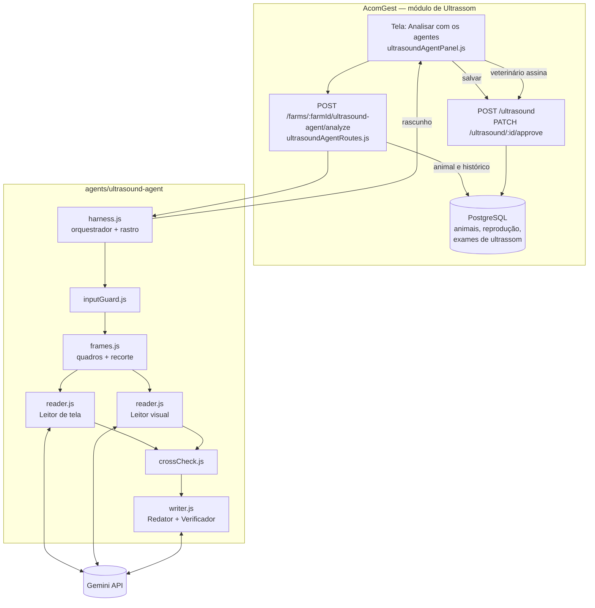

# Arquitetura

O agente é um orquestrador com sete etapas: três usam IA (Leitor de tela, Leitor visual e Redator) e quatro são código (Guarda de entrada, Preparo dos quadros, Cruzamento e Verificador). A IA percebe e escreve; o código prepara, confere e verifica; o veterinário decide.

## Componentes

| Peça | Arquivo | Papel |
| --- | --- | --- |
| Orquestrador | `src/harness.js` | Chama as etapas em ordem, guarda o rastro, limita a 12 etapas e devolve um status explícito em toda saída |
| Guarda de entrada | `src/agents/inputGuard.js` | Tipo, tamanho e quantidade de arquivos; animal e data; hash SHA-256 |
| Preparo dos quadros | `src/frames.js` | ffmpeg: 8 quadros por vídeo, com instante; recorte da região da imagem; miniaturas; pasta temporária apagada no fim |
| Leitor de tela | `src/agents/reader.js` (`readScreen`) | Transcreve o texto do aparelho, sem interpretar; JSON Schema validado pelo código; 1 nova tentativa |
| Leitor visual | `src/agents/reader.js` (`readVisual`) | Descreve cada estrutura citando os quadros, sem cadastro, histórico ou texto da tela; JSON Schema validado e normalizado pelo código (`src/schema.js`) |
| Cruzamento | `src/agents/crossCheck.js` + `src/harness.js` | 10 verificações entre as fontes, mais o alerta de recorte não encontrado; mostra as duas versões e não decide qual está certa |
| Redator + Verificador | `src/agents/writer.js` | O LLM escreve só com os fatos; o Verificador recusa número inventado ou recomendação |
| Cliente Gemini | `src/gemini.js` | Chave no cabeçalho, temperatura 0, tempo-limite de 60 s, sem dependências |
| Modo simulado | `src/simulated.js` | Só para demonstração e testes sem chave; a tela e a API marcam "simulado" |
| Rota na AcomGest | `backend/modules/ultrasound/agent/ultrasoundAgentRoutes.js` | Permissão, isolamento por fazenda, carrega o histórico, chama o agente, não grava |
| Tela | `frontend/src/domain/ultrasound/ultrasoundAgentPanel.js` | Envio, laudo nas 6 seções, salvar rascunho, assinatura pelo veterinário |
| Regra de assinatura | `backend/controllers/farmResourceController.js` (`approveResourceAction`) | Exame com IA = Sim só é aprovado pelo perfil Veterinário |

Os três últimos itens ficam no repositório da AcomGest, não neste.

## Por que vários agentes, e não um só

- **Separar o texto da tela da imagem:** quando uma só chamada fazia as duas coisas com o cadastro junto, o texto "Gabriel" da tela virou o "animal" do exame e gerou um bloqueio falso. Agora o texto é só transcrito, e o Leitor visual recebe apenas os recortes da imagem.
- **Separar perceber de conferir:** o modelo de visão descreve, mas não tem acesso confiável ao histórico do animal. O Cruzamento roda com o dado real do banco e é auditável linha a linha.
- **Separar escrever de verificar:** um LLM escreve bem, mas pode inventar um número. O Verificador é código e recusa qualquer número que não esteja nos fatos.
- **Um responsável por conflito:** o orquestrador consolida; um `bloqueio` impede a assinatura; o veterinário resolve.

## Onde fica o estado

- **Durante a execução:** um único objeto `run` no orquestrador (rastro das etapas). Os quadros ficam numa pasta temporária que é apagada no fim. Nada é persistido pelo agente.
- **Depois:** o rascunho só existe no banco quando o usuário salva, como um exame comum do módulo de Ultrassom, com `ai_enabled = "Sim"` e a narrativa em `notes`. `ai_confidence` fica vazio na v3.
- **Memória de longo prazo:** o histórico do animal na AcomGest (reprodução e exames). O agente não guarda memória própria entre execuções.

## Implantação

| Item | Onde |
| --- | --- |
| API | Google Cloud Run, `southamerica-east1` (a mesma imagem da AcomGest, com a pasta `agents/`; o build falha se o ffmpeg não estiver disponível) |
| Banco | PostgreSQL no Supabase, São Paulo |
| Modelo | Gemini API (`ACOMGEST_ULTRASOUND_VLM_MODEL` ou `ACOMGEST_GEMINI_MODEL`, chave `GEMINI_API_KEY`) |
| Demonstração sem chave | `ACOMGEST_ULTRASOUND_AGENT_SIMULATED=true` |

## O que ainda não existe

- **Guardar a mídia:** a AcomGest não armazena o arquivo do exame nem os quadros. Para reabrir o vídeo depois, falta um armazenamento (Cloud Storage ou Supabase Storage).
- **Comparação de imagens com exames anteriores:** como as imagens não ficam guardadas, a seção 4 do laudo só lista os registros anteriores.
- **Parâmetros por fazenda:** as faixas clínicas estão em `config.js`; falta levá-las para a tela de configurações da fazenda.
- **Avaliação com exames reais:** o avaliador (`eval/run-eval.js`) está pronto, mas falta o conjunto de exames rotulado por veterinário (ver [avaliação](avaliacao-e-guardrails.md)).
- **Teste automatizado da rota contra PostgreSQL:** em produção a rota roda no PostgreSQL, mas o teste automatizado roda em SQLite.
