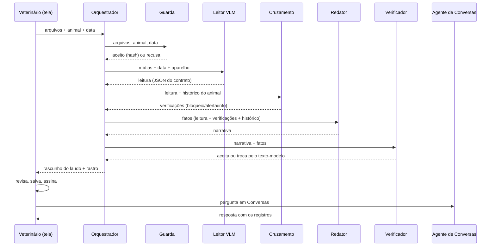

# Especificação dos agentes — área, contrato e interação

Este documento é a base para escrever e revisar os prompts. Cada agente tem uma área própria, recebe um contrato de entrada definido e entrega um contrato de saída definido. Nenhum agente fala direto com outro: o orquestrador (`src/harness.js`) passa as saídas adiante e guarda o rastro.

## Mapa de interação

## Regras que valem para todos

- **Só o veterinário decide:** nenhum agente grava, aprova, diagnostica, prescreve ou indica dose.
- **Fato vem do sistema ou da tela:** número só entra se estiver escrito na tela do aparelho ou registrado na AcomGest.
- **Dúvida vira sinal, não chute:** o que não está visível fica nulo, com confiança 0, e o veterinário vê o alerta.
- **Saída sempre no contrato:** cada agente devolve um formato fixo; fora dele, o orquestrador tenta uma vez de novo ou falha fechado.
- **Permissão e fazenda:** os dados que os agentes recebem já vêm filtrados pelo perfil do usuário e pela fazenda.

## 1. Guarda de entrada

| Item | Especificação |
| --- | --- |
| Área | Validar a entrada antes de gastar IA |
| Tipo | Regra fixa (sem prompt) |
| Entrada | Arquivos (tipo, tamanho), animal (id, brinco), data do exame |
| Saída | `{ ok, problems[], media[{ index, mimeType, bytes, sha256 }] }` |
| Regras | JPEG, PNG, MP4, MOV ou AVI; até 4 arquivos; até 14 MB no total; data AAAA-MM-DD; animal obrigatório |
| Quando falha | Devolve a lista de problemas em português; o Leitor não é chamado |
| Arquivo | `src/agents/inputGuard.js` |

## 2. Leitor (VLM)

| Item | Especificação |
| --- | --- |
| Área | Percepção: ler o texto da tela e descrever a imagem do exame |
| Tipo | VLM (Gemini, temperatura 0, saída JSON por schema) |
| Entrada | Mídias do exame + data informada + aparelho informado |
| Saída | `screen_text { animal_id, exam_date, equipment, measurements[{label, value, unit}] }`; `findings` com 7 campos (`pregnancy`, `gestational_age_days`, `corpus_luteum_mm`, `follicle_largest_mm`, `uterine_horn`, `fluid_presence`, `fetal_heartbeat`), cada um `{ value, confidence 0–1, evidence, source }`; `image_quality { usable, issues[] }` |
| `source` | `medida_na_tela`, `texto_na_tela`, `observacao_visual` ou `nao_visivel` |
| Não pode | Estimar número a olho; escrever diagnóstico, prognóstico, tratamento ou recomendação |
| Quando falha | JSON fora do contrato: 1 nova tentativa com a lista de erros; depois `leitura_invalida`. Rede ou tempo (60 s): `falha_no_modelo` |
| Versão do prompt | `ultrassom-leitor-v2` (registrada na proveniência de cada laudo) |
| Saída extra (v2) | `technical` (modo, transdutor, frequência, profundidade, preset, vídeo, qualidade, artefatos); `structures` (estrutura da ontologia, confiança ALTA/MODERADA/BAIXA com justificativa, lado, dimensão estimada com `calibrated`); `hypotheses` ("compatível com", confiança, como confirmar); `limitations` (não visualizado, ausência confirmada, limitação técnica). Nada disso entra nos campos do prontuário |
| Arquivo | `src/agents/reader.js`, contrato em `src/schema.js` |

**Prompt atual (v2, resumo):** especialista em diagnóstico por imagem veterinário, com os quatro princípios da equipe (percepção separada de decisão, referência externa, calibração, confiança explícita); campos do prontuário só com medida da tela; estimativas e hipóteses "compatível com" em seções separadas; espécie informada pelo sistema; nunca tratamento, dose ou prognóstico. Texto completo em `src/agents/reader.js`.

**Pontos para evoluir o prompt:** vocabulário dos aparelhos mais usados (abreviações de tela como CL, IG, CRL, BPD); exemplos de exames rotulados (few-shot) quando houver base; orientação por tipo de exame (diagnóstico de gestação, avaliação ovariana, sexagem fetal).

## 3. Cruzamento

| Item | Especificação |
| --- | --- |
| Área | Conferir a leitura com o histórico real do animal |
| Tipo | Regras fixas (sem prompt), auditáveis |
| Entrada | Leitura do Leitor + animal + data + histórico (serviços: IA, IATF, cobertura, TE; exames anteriores) |
| Saída | `checks[{ code, severity, message, data }]`, `blocked`, `lastService`, `previousExam` |
| Bloqueia | Imagem inutilizável; brinco da tela diferente do animal; medida numérica sem origem na tela |
| Alerta | Data divergente (>1 dia); medida fora da faixa; confiança < 60%; prenhe sem serviço em 300 dias; idade gestacional ≠ dias desde o serviço (±10); vazia após positivo em 90 dias |
| Parâmetros | `src/config.js` (faixas iniciais para bovinos, a validar com veterinário) |
| Arquivo | `src/agents/crossCheck.js` |

## 4. Redator (LLM)

| Item | Especificação |
| --- | --- |
| Área | Escrever a narrativa do laudo |
| Tipo | LLM (Gemini) |
| Entrada | Somente os fatos estruturados: animal, exame, achados com valor, verificações, último serviço, exame anterior |
| Saída | Texto em português, até 6 frases |
| Não pode | Acrescentar número, data, achado, causa, diagnóstico, prognóstico, tratamento ou recomendação |
| Quando falha | Erro do modelo: entra o texto-modelo determinístico |
| Arquivo | `src/agents/writer.js` (`WRITER_INSTRUCTIONS`) |

## 5. Verificador

| Item | Especificação |
| --- | --- |
| Área | Garantir que o texto do LLM só diz o que está nos fatos |
| Tipo | Regra fixa |
| Entrada | Narrativa + fatos |
| Saída | `{ ok, unknownNumbers[], forbiddenTerms }` |
| Regra | Todo número da narrativa precisa existir nos fatos; termos de recomendação ou dose reprovam |
| Quando reprova | O orquestrador descarta a narrativa e usa o texto-modelo |
| Arquivo | `src/agents/writer.js` (`verifyNarrative`) |

## 6. Agente de Conversas (perguntas)

| Item | Especificação |
| --- | --- |
| Área | Responder perguntas sobre os animais em Conversas → Agente AcomGest |
| Tipo | LLM (Gemini) + Verificador |
| Entrada | Pergunta + fatos dos animais citados pelo brinco ou nome (até 3): ficha, serviços reprodutivos e exames de ultrassom, conforme a permissão do usuário |
| Saída | Resposta em até 5 frases, citando as datas dos registros; marcação "resposta do agente, conferida" ou "resumo dos registros" |
| Não pode | Responder sem registro, estimar, diagnosticar, prescrever; dados de outra fazenda |
| Quando falha | Sem animal citado: pede o brinco ou o nome. Número fora dos fatos: resumo determinístico dos registros |
| Arquivo | `backend/modules/agents/agentChatRoutes.js` (`ANSWER_INSTRUCTIONS`) |

## Estado compartilhado e responsabilidade por conflito

- **Estado:** o objeto `run` do orquestrador (etapas, tempos, tokens, tentativas). Não há memória entre execuções; a memória de longo prazo é o histórico da AcomGest.
- **Conflito:** o orquestrador consolida. Um `bloqueio` impede a assinatura até o veterinário corrigir. Quando o Verificador e o Redator discordam, vale o Verificador.

## Laudo

O laudo segue o formato de laudo de clínica: cabeçalho com a logo da AcomGest; **Dados** (animal, espécie, raça, sexo, categoria, data, fazenda, solicitante, aparelho); **Condições do exame**; **Relatório ultrassonográfico** (campos editáveis, com a confiança da IA em cada um); **Pontos de conferência dos agentes**; **Rascunho do agente**; **Conclusão do médico-veterinário**; **Imagens do exame** (quadros do vídeo); **Assinatura eletrônica** com nome, CRMV, data e código do exame. O PDF é gerado pelo navegador ("Imprimir ou salvar PDF").
