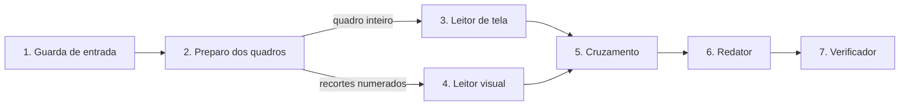

# Especificação dos agentes — área, contrato e interação

Versão do código: `ultrassom-tela-v1 + ultrassom-visual-v3` (24/10/2026). Cada etapa abaixo existe no código, no arquivo indicado. O fluxo completo, com entradas e saídas, está no [README](../README.md#fluxo-do-agente-entradas-lógica-e-saídas).

## Mapa de interação

Nenhuma etapa chama outra diretamente: o orquestrador (`src/harness.js`) passa o resultado de uma para a outra, registra cada etapa no rastro e termina com um status explícito. O limite é de 12 etapas por execução.

## Regras que valem para todos

- **Só o veterinário decide:** nenhuma etapa grava, aprova, diagnostica, prescreve ou indica dose.
- **Fontes separadas:** cadastro, histórico, texto da tela e observação visual nunca se misturam. O Leitor visual não recebe cadastro, histórico nem texto da tela.
- **Número só da tela:** medida só entra no rascunho se foi feita na tela do aparelho. Não há porcentagem de confiança.
- **Dúvida vira sinal, não chute:** identificação sem quadro conferível vira "hipótese"; gestação sem quadro vira "inconclusiva"; o que não pôde ser avaliado vai para `not_evaluated`.
- **Saída sempre no contrato:** fora do JSON Schema, 1 nova tentativa com a lista de erros; depois a execução falha fechada.
- **Permissão e fazenda:** a rota da AcomGest só carrega dados da fazenda e do perfil do usuário.

## 1. Guarda de entrada

| Item | Especificação |
| --- | --- |
| Tipo | Código |
| Entrada | Arquivos (tipo, tamanho), animal (id, brinco), data do exame |
| Saída | `{ ok, problems[], media[{ index, mimeType, bytes, sha256 }] }` |
| Regras | JPEG, PNG, MP4, MOV ou AVI; até 4 arquivos; até 14 MB no total; data AAAA-MM-DD; animal obrigatório |
| Quando falha | `entrada_recusada`, com os problemas em português; nenhum modelo é chamado |
| Arquivo | `src/agents/inputGuard.js` |

## 2. Preparo dos quadros

| Item | Especificação |
| --- | --- |
| Tipo | Código (ffmpeg) |
| Entrada | Arquivos aprovados pela Guarda |
| O que faz | Extrai 8 quadros por vídeo, nos instantes `(i + 0,5) × duração ÷ 8`; detecta a região da imagem de ultrassom pela densidade de pixels no quadro do meio e recorta todos os quadros por ela; gera uma miniatura de cada quadro. Imagens viram 1 quadro. Se a região não for encontrada, o quadro segue inteiro com `cropped: false`, o Leitor visual é avisado e sai o alerta `recorte_nao_encontrado` |
| Saída | `frames[{ index, media, time_s, full, roi, thumb }]`, `coverage[{ media, kind, duration_s, frames, times_s, roi }]`, `roi` |
| Quando falha | `falha_no_processamento` (diferente de "sem achados") |
| Arquivos temporários | Pasta temporária própria, apagada no fim da execução |
| Arquivo | `src/frames.js` |

## 3. Leitor de tela

| Item | Especificação |
| --- | --- |
| Tipo | Gemini, temperatura 0, saída por JSON Schema |
| Entrada | O quadro inteiro do meio de cada arquivo |
| Saída | `texts[{ text, position, likely_role }]`, `exam_date`, `exam_time`, `equipment`, `transducer`, `frequency_mhz`, `depth_cm`, `measurements[{ label, value, unit }]` |
| Regras | Só transcreve; não decide o que um texto significa (um nome na área do paciente pode ser o animal, o proprietário ou outro campo); medida só quando houve medição na tela; números de escala não são medida; não descreve a imagem |
| Quando falha | `leitura_invalida` após 1 nova tentativa; `falha_no_modelo` se o Gemini não responder em 60 s |
| Prompt | `ultrassom-tela-v1` (`SCREEN_INSTRUCTIONS` em `src/agents/reader.js`); contrato `SCREEN_SCHEMA` em `src/schema.js` |

## 4. Leitor visual

| Item | Especificação |
| --- | --- |
| Tipo | VLM Gemini, temperatura 0, saída por JSON Schema |
| Entrada | Só os recortes, rotulados "Quadro k · t s", e a espécie informada pelo sistema |
| Saída por estrutura | `identification`, `identification_status` (identificado / hipótese / não identificado com segurança), `frames[]`, `location_in_frame`, `evidence`, `shape`, `contours`, `echogenicity`, `echotexture`, `content`, `internal_features`, `parent_id`, `relations`, `possible_artifact`, `state` (compatível com o esperado no que foi visualizado / alteração morfológica suspeita / inconclusiva), `state_basis`, `suspected_changes[{ observed, possible_meaning, pathologic_hypothesis, differentials[], confirm_by }]`, `limitations` |
| Outras saídas | `image_quality { usable, issues[] }`, `not_evaluated[{ structure, reason }]`, `gestation { status, frames, basis }`, `preliminary_interpretation { text, basis }` |
| Regras | Princípios da equipe: percepção separada de decisão, referência externa (como confirmar), sem invenção (sem lateralidade, medidas, contagens, batimentos ou percentuais), evidência com os quadros. A mesma estrutura em vários quadros é uma estrutura. Não força gestação: clipe ovariano é descrito como ovariano |
| Normalização em código | Remove quadros que não existem; "identificado" sem quadro vira "hipótese"; gestação identificada sem quadro vira "inconclusiva"; marca estruturas fora da lista reprodutiva (`in_ontology`) |
| Lista de estruturas | ovário, folículo, corpo lúteo, cavidade luteal, corno uterino, corpo uterino, conteúdo uterino, vesícula gestacional, embrião/feto |
| Quando falha | Igual ao Leitor de tela |
| Prompt | `ultrassom-visual-v3` (`VISUAL_INSTRUCTIONS` em `src/agents/reader.js`); contrato `VISUAL_SCHEMA` e `normalizeVisual` em `src/schema.js` |

## 5. Cruzamento

| Item | Especificação |
| --- | --- |
| Tipo | Código |
| Entrada | Saída dos dois leitores, medidas da tela, cadastro do animal, data do exame e histórico (serviços IA, IATF, cobertura, TE; exames anteriores) |
| Saída | `checks[{ code, severity, message, data, section }]`, `blocked`, `lastService`, `previousExam` |
| Princípio | Compara as fontes sem decidir qual está certa; mostra as duas para o veterinário |
| Bloqueio | `imagem_inutilizavel` |
| Alerta | `recorte_nao_encontrado` (o Leitor visual recebeu o quadro inteiro; gerado no orquestrador), `identificacao_a_conferir`, `data_a_conferir`, `medida_fora_da_faixa`, `idade_gestacional_divergente` (tolerância de 10 dias), `gestacao_sem_servico` (janela de 300 dias), `positivo_anterior` (janela de 90 dias; não equivale a resultado negativo) |
| Informação | `identificacao_confere`, `identificacao_ausente_na_tela`, `idade_gestacional_coerente` |
| Parâmetros | `src/config.js` (faixas iniciais para bovinos, a validar com veterinário) |
| Arquivo | `src/agents/crossCheck.js` |

## 6. Redator

| Item | Especificação |
| --- | --- |
| Tipo | Gemini |
| Entrada | Só os fatos: exame, cobertura, achados visuais com quadros e estado, gestação, não avaliados, medidas da tela e pontos de conferência |
| Saída | Texto em português, até 6 frases, terminando com a necessidade de aprovação do veterinário |
| Não pode | Acrescentar número, medida, lateralidade, causa, diagnóstico definitivo, prognóstico, tratamento ou recomendação |
| Quando falha | Entra o texto-modelo determinístico (`templateNarrative`) |
| Arquivo | `src/agents/writer.js` (`WRITER_INSTRUCTIONS`, `buildFacts`) |

## 7. Verificador

| Item | Especificação |
| --- | --- |
| Tipo | Código |
| Entrada | Narrativa + fatos |
| Saída | `{ ok, unknownNumbers[], forbiddenTerms }` |
| Regra | Todo número da narrativa precisa existir nos fatos; termos como "recomend", "prescrev", "dose de" e "diagnóstico definitivo" reprovam |
| Quando reprova | A narrativa é descartada e entra o texto-modelo |
| Arquivo | `src/agents/writer.js` (`verifyNarrative`) |

## Na AcomGest (fora deste repositório)

| Peça | O que faz |
| --- | --- |
| Rota `POST /farms/:farmId/ultrasound-agent/analyze` | Confere fazenda e permissão, carrega o animal e o histórico, roda o agente e não grava nada |
| Tela do módulo de Ultrassom | Laudo nas 6 seções (achados visuais com os quadros, interpretação preliminar, limitações, comparação com exames anteriores, conferência de cadastro, identificação e datas, revisão veterinária); salvar rascunho; assinatura |
| Regra de assinatura | Exame com IA = Sim só é aprovado pelo perfil Veterinário |
| Agente AcomGest em Conversas | Mostra os exames redigidos pelo agente e responde perguntas sobre os animais citados, com os registros e o mesmo Verificador |

## Estado compartilhado e conflito

- **Estado:** o objeto `run` do orquestrador (etapas, tempos, tokens, tentativas). Não há memória entre execuções; a memória de longo prazo é o histórico da AcomGest.
- **Conflito:** um `bloqueio` impede a assinatura até ser resolvido. Quando o Verificador e o Redator discordam, vale o Verificador.
