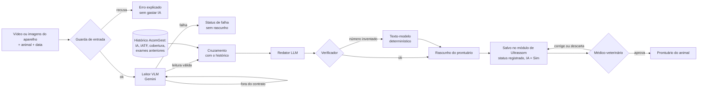

# Fluxo do agente — entradas, lógica e saídas

O Agente de Ultrassonografia AcomGest transforma o vídeo ou as imagens exportados do aparelho de ultrassom em um rascunho de prontuário do animal, cruzado com o histórico reprodutivo dele, e entrega esse rascunho para o médico-veterinário assinar.

## Entradas

| Entrada | De onde vem | Regras |
| --- | --- | --- |
| Vídeo curto ou imagens exportados do aparelho | Upload no módulo de Ultrassom | JPEG, PNG, MP4, MOV ou AVI; até 4 arquivos; até 14 MB no total |
| Animal do exame | Escolhido na tela, entre os animais da fazenda | Precisa existir na fazenda do usuário |
| Data do exame, aparelho, nome do veterinário | Tela | Data obrigatória (AAAA-MM-DD) |
| Serviços reprodutivos do animal | Banco da AcomGest (Reprodução) | Inseminação, IATF, cobertura, transferência de embrião; eventos cancelados ficam de fora |
| Exames anteriores do animal | Banco da AcomGest (Ultrassom) | Data e resultado de gestação |
| Parâmetros clínicos | `src/config.js` | Faixas iniciais para bovinos, a validar com veterinário; configuráveis |

## Lógica

Cada etapa recebe o resultado da anterior e grava o que fez no **rastro** (`trace`), que é o estado compartilhado da execução: nome da etapa, horário, sucesso, erros, tokens e tempo.

| # | Etapa | Tipo | Recebe | Entrega | Quando falha |
| --- | --- | --- | --- | --- | --- |
| 1 | Guarda de entrada | Regra fixa | Arquivos, animal, data | Lista de mídias aceitas com hash SHA-256 | Recusa com a lista de problemas, sem chamar a IA |
| 2 | Leitor | VLM (Gemini) | Mídias + data | JSON no contrato `schema.js`: texto da tela, 7 achados com valor, confiança, evidência e origem; qualidade da imagem | Resposta fora do contrato: 1 nova tentativa com o erro; depois falha fechada. Erro de rede ou tempo: status `falha_no_modelo` |
| 3 | Cruzamento | Regras fixas | Leitura + histórico | Verificações com severidade (`bloqueio`, `alerta`, `info`) e o dado que as originou | — |
| 4 | Redator | LLM (Gemini) | Só os fatos estruturados das etapas 2 e 3 | Narrativa de até 6 frases | Erro do modelo: usa o texto-modelo |
| 5 | Verificador | Regra fixa | Narrativa + fatos | Aceita ou recusa a narrativa | Número fora dos fatos ou termo de recomendação: descarta a narrativa e usa o texto-modelo |

**Regras do Leitor que o código confere, não só o prompt:**
- Medida numérica (idade gestacional, corpo lúteo, folículo) só entra se veio de uma medida escrita na tela (`source = medida_na_tela`). Número estimado a olho vira `bloqueio` e fica fora do rascunho.
- Valor nulo tem confiança 0. Confiança abaixo de 60% vira alerta de conferência.

**Verificações do Cruzamento:**

| Código | Severidade | Quando |
| --- | --- | --- |
| `imagem_inutilizavel` | bloqueio | O Leitor marcou a imagem como ilegível |
| `animal_divergente` | bloqueio | O brinco na tela é diferente do animal escolhido |
| `medida_sem_tela` | bloqueio | Medida numérica sem origem na tela |
| `data_divergente` | alerta | Data na tela difere em mais de 1 dia da data informada |
| `fora_da_faixa` | alerta | Medida fora da faixa configurada |
| `baixa_confianca` | alerta | Confiança abaixo do mínimo |
| `prenhe_sem_servico` | alerta | Prenhe sem serviço registrado nos últimos 300 dias |
| `idade_gestacional_divergente` | alerta | Idade gestacional lida difere em mais de 10 dias dos dias desde o último serviço |
| `vazia_apos_positivo` | alerta | Vazia, com exame anterior positivo nos últimos 90 dias |
| `idade_gestacional_coerente` | info | Idade gestacional confere com o último serviço |
| `animal_nao_identificado_na_tela` | info | A tela não mostra o brinco |

**Conflitos:** quem consolida é o orquestrador (`harness.js`). Qualquer `bloqueio` torna o rascunho não aprovável até o veterinário corrigir; o veterinário é quem resolve a divergência, nunca o modelo.

## Saídas

| Saída | Formato | Para quê |
| --- | --- | --- |
| `draft` | Campos do exame de ultrassom da AcomGest (`pregnancy`, `gestational_age_days`, `corpus_luteum_mm`, `diameter_mm`, `uterine_horn`, `fluid_presence`, `ai_enabled`, `ai_confidence`, `notes`) | Salvar no módulo de Ultrassom com um clique |
| `reading` | Leitura completa do Leitor, com confiança e evidência por campo | Mostrar ao veterinário o que sustenta cada valor |
| `checks` | Verificações do Cruzamento | Mostrar o que conferir antes de assinar |
| `provenance` | Hash de cada mídia, modelo, versão do prompt | Auditoria: qual arquivo e qual modelo geraram o rascunho |
| `trace` | Etapas, tempos, tokens, tentativas | Observabilidade e custo |
| `status` | `rascunho_aguardando_veterinario`, `entrada_recusada`, `sem_modelo`, `leitura_invalida`, `falha_no_modelo` | A tela e a API sabem o que aconteceu |

**O que o agente nunca faz:** gravar no prontuário sem o veterinário, aprovar um exame, escrever diagnóstico, prognóstico, tratamento, medicamento ou dose.

## Depois do agente

1. O usuário salva o rascunho: o exame entra no módulo de Ultrassom com status **registrado** e **IA = Sim**.
2. Só um usuário com perfil **Veterinário** aprova um exame redigido pela IA (`PATCH /ultrasound/:id/approve`). Gerente e Administrador recebem 403 `VETERINARIAN_REQUIRED`.
3. Aprovado, o exame passa a fazer parte da ficha do animal e dos indicadores de reprodução.
